  

  
  
  
  
  
  

  
  
  

---

## 👋 About me

I'm a backend developer from Istanbul. I build web apps with ASP.NET Core and SQL Server, and I enjoy the parts that are easy to get wrong: access control, data that must stay correct when two people click at the same time, and queries that stay fast.

I'm looking for a junior or mid-level role abroad. My old account (**coderVi**) was deleted, so the projects below are new and written from scratch.

---

## 🚀 Projects

Every repository has its own README that explains what it does and why it is built that way.

| | Project | What it is | What I practised |
| :-: | :--- | :--- | :--- |
| ⚖️ | [**LawFirm**](https://github.com/codervi/LawFirm) | Law firm website with an admin panel | MVC with Areas, repository pattern, appointment booking, a unique index that blocks double bookings |
| 🏗️ | [**Kestrel**](https://github.com/codervi/Kestrel) | Civil engineering firm website with an admin panel | Razor Pages, quote requests, safe image upload (extension, size and file signature checks) |
| 🧠 | [**Linden**](https://github.com/codervi/Linden) | Record keeping for a psychologist, with an admin panel | AES-256-GCM encrypted notes, audit log, roles, lockout, rate limiting |
| 💼 | [**Tern**](https://github.com/codervi/Tern) | Job board with a REST API | JWT login, search with filters and paging in SQL, a SQL view, indexes |
| 🛒 | [**Fernhill**](https://github.com/codervi/Fernhill) | Small web shop | AJAX cart, stock that stays correct with concurrent orders, price snapshot in orders |
| 📋 | [**Larch**](https://github.com/codervi/Larch) | Kanban board | Drag and drop in plain JavaScript, card order kept correct in the database |
| 📅 | *Booking system* | Reservations (in progress) | Overlap checks, availability queries, stored procedures, reports |

---

## 🛠️ What I work with

| Area | Tools |
| :--- | :--- |
| **Backend** | C#, ASP.NET Core (MVC, Razor Pages, Web API), Entity Framework Core, LINQ, dependency injection, async code |
| **Auth & security** | Identity, roles, cookies, JWT, CSRF protection, input validation, encryption of sensitive data |
| **Database** | Microsoft SQL Server, data modelling, indexes, views, transactions |
| **Front end** | HTML, CSS, JavaScript (no framework needed) |
| **Testing** | xUnit for business rules |

---

## 📊 GitHub stats

  
  

---

## 🎓 Education & languages

- **Istanbul Aydın University:** Computer Programming
- **Arı Bilgi:** Software Specialization
- **Certificates:** Cisco Cybersecurity Essentials, BTK Academy (GitHub and Networking), Linux Essentials
- **Languages:** Turkish (native) · Arabic (B2) · English (B1, improving every month)

---

