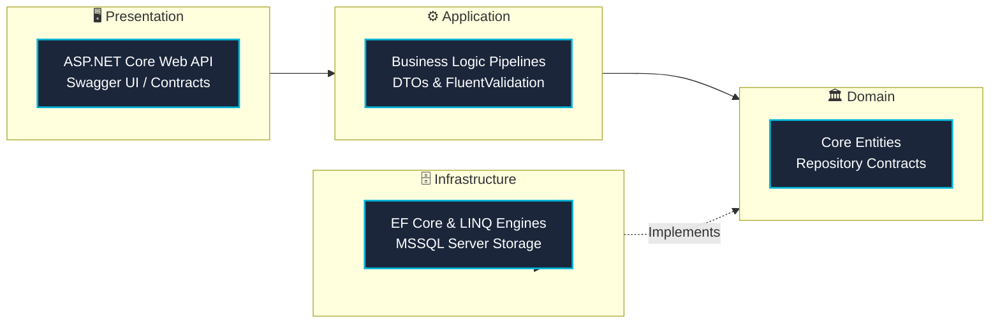

<div align="center">
<!-- HEADER BANNER -->

<!-- STATUS & QUICK BADGES -->
<p align="center">
  
  
  <a href="https://linkedin.com/in/asmtylmz" target="_blank"></a>
  <a href="mailto:mr.asmtylmz@gmail.com"></a>
  
</p>
</div>
---
💻 System Overview
```csharp
using System.Architecture.Clean;

namespace Profile.Developer;

public sealed class AbdulsametYilmaz : BackendEngineer
{
    public string Role       => "ASP.NET Core & Enterprise Backend Architect";
    public string Focus      => "Scalable Web APIs, Clean Architecture & Event-Driven Systems";
    public string Note       => "Rebuilding open-source portfolio (Previously known as @coderVi)";
    public string[] Mindset  => ["High Performance", "Maintainability", "Clean Code", "SOLID"];

    public void Execute() => BuildSustainableSystems();
}
```
---
🧩 Technology Matrix
<div align="center">
Domain	Technologies & Frameworks
Backend & Core	   
Database & Caching	  
Patterns & Architecture	   
Tooling & Environments	   
</div>
---
🏗️ Architectural Blueprint

---
📂 Featured Repositories
Repository	Scope & Implementation	Architectural Focus
AspWebApi Infrastructure	Standardized RESTful enterprise API base with generic repository pattern, global middleware exceptions, and structured payloads.	`Clean Architecture` `EF Core`
Corporate Web System	End-to-end CMS with robust role-based access control (RBAC), relational database transactions, and optimized indexing.	`Layered Architecture` `MSSQL`
Logic & OOP Repository	Algorithmic implementations, memory safety benchmarks, and object-oriented behavioral design patterns.	`Advanced C#` `Design Patterns`
---
📈 Telemetry & Analytics
<div align="center">
  
  
</div>
<div align="center">
  
</div>
---
<div align="center">
  <sub>⚡ Developed with high precision by <strong>Abdulsamet Yılmaz</strong>. Designed for scalability, resilience, and clean design.</sub>
</div>
